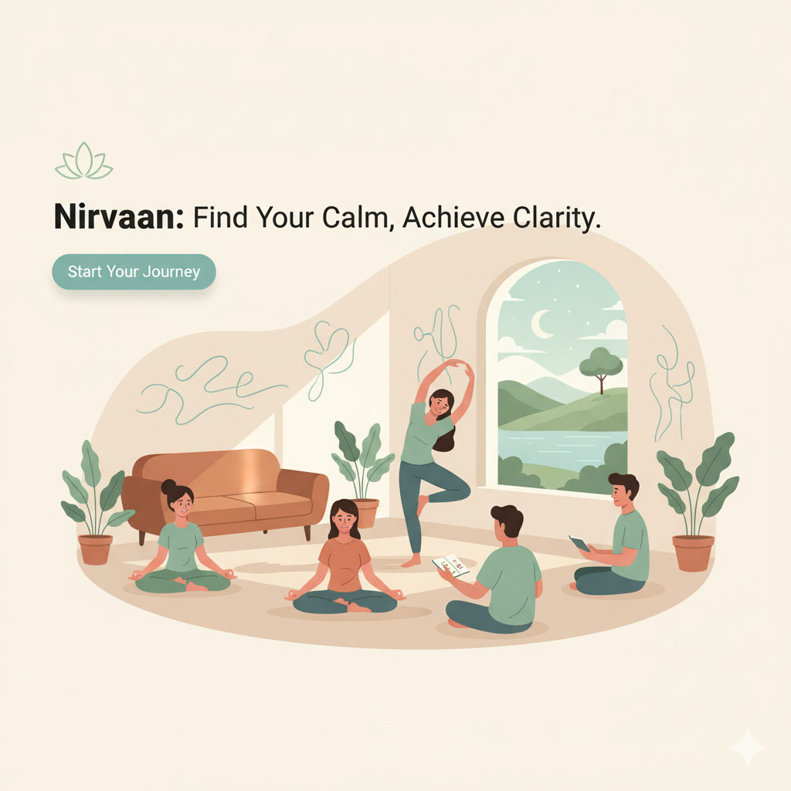

# Nirvaan

<p align="center">
	
	
	
	
	
</p>

<p align="center">
	<strong>A modern student wellbeing and counselling platform.</strong><br/>
	Designed to feel calm, private, and trustworthy while helping students find the right support quickly.
</p>

<p align="center">
	
</p>

## Overview

Nirvaan connects students, counsellors, and institutes in one streamlined experience.
The platform focuses on three core outcomes:

1. Early self-awareness through guided screening.
2. Better support access through counsellor discovery and booking.
3. Ongoing help through resources, chat, and institute forums.

## Design Language (Aligned With The Website)

Nirvaan uses a warm, soft, modern visual tone that emphasizes comfort and clarity:

- Primary mood: light, minimal, calm, and professional.
- Brand accents: warm beige and seafoam highlights.
- UX principles: privacy-first, low-friction flows, readable typography, and card-based layouts.

Core palette used in the app:

- `#FAF7F2` background (pearl/oyster shell)
- `#E6CDB5` brand accent
- `#D9B491` strong accent
- `#B6D2C8` soft supporting accent
- `#1F2937` primary text

## Key Features

- Secure authentication and protected flows using NextAuth.
- Real-time chat-ready architecture powered by Stream Chat SDK.
- Counsellor profiles and booking-ready components.
- Institute forums for student-community interaction.
- Guided screening flow for first-level support direction.
- Resource discovery for evidence-informed wellbeing content.
- Admin metrics endpoint for operational visibility.

## Tech Stack

| Layer | Technology |
| --- | --- |
| Frontend | Next.js 15 (App Router), React 19 |
| Styling | Tailwind CSS 4 + custom design tokens |
| Auth | NextAuth.js |
| Database | MongoDB with Mongoose |
| Realtime/Chat | Stream Chat + Stream Chat React |
| Tooling | ESLint 9 |

## Project Structure

```text
nirvaan/
|- app/
|  |- api/                   # Route handlers (auth, profile, forums, metrics)
|  |- Components/            # Reusable UI + context providers
|  |- admin/                 # Admin dashboard views
|  |- counsellor/            # Counsellor discovery pages
|  |- dashboard/             # User dashboard
|  |- forum/                 # Dynamic forum pages
|  |- resources/             # Resource center
|  |- screening/             # Screening flow
|  |- universities/          # Institute related pages
|  |- globals.css            # Design tokens and utility layer
|  |- layout.js              # Root layout
|  |- page.js                # Homepage
|- lib/                      # DB and stream utilities
|- models/                   # Mongoose models
|- public/                   # Static assets
```

## API Surface (Current)

- `/api/auth/[...nextauth]` authentication handler.
- `/api/user/profile` user profile read/update.
- `/api/counsellors` counsellor listing/management.
- `/api/institutes` institute listing/management.
- `/api/forum/join` and `/api/forum/join/delete` forum participation.
- `/api/admin/metrics` admin-facing metrics endpoint.

## Quick Start

### Prerequisites

- Node.js 18+
- npm
- MongoDB connection string

### 1) Install

```bash
npm install
```

### 2) Configure Environment

Create `.env.local` in the project root:

```bash
MONGODB_URI=your_mongodb_connection_string
NEXTAUTH_SECRET=your_nextauth_secret
NEXTAUTH_URL=http://localhost:3000
```

### 3) Run Development Server

```bash
npm run dev
```

Open `http://localhost:3000`.

## Available Scripts

```bash
npm run dev     # Next dev with Turbopack
npm run build   # Production build
npm run start   # Start production server
npm run lint    # ESLint checks
```

## Professional Notes For Teams

- Architecture is modular and App Router-friendly for feature scaling.
- Design tokens in `app/globals.css` make branding adjustments straightforward.
- API routes are already separated by domain and can be extended into service layers.
- Ready for CI addition (`lint`, `build`) with minimal setup.

## Contributing

1. Fork the repository.
2. Create a feature branch: `git checkout -b feature/your-feature`.
3. Commit changes: `git commit -m "feat: add your feature"`.
4. Push branch: `git push origin feature/your-feature`.
5. Open a pull request.

## License

MIT License. See `LICENSE` for details.

<p align="center">
	Built for student wellbeing with a modern, human-centered product approach.
</p>
